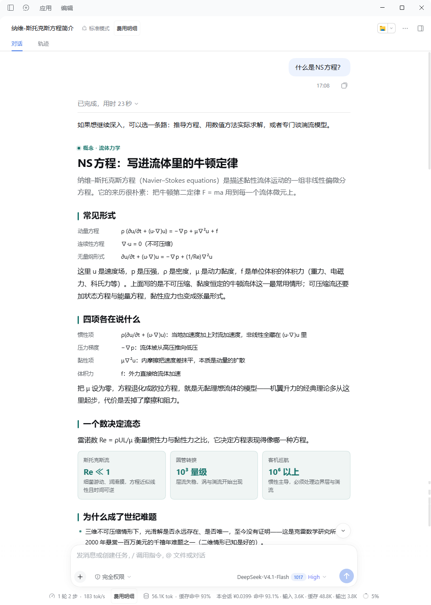
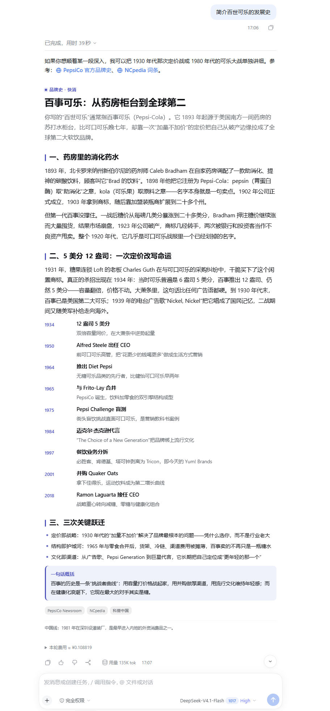
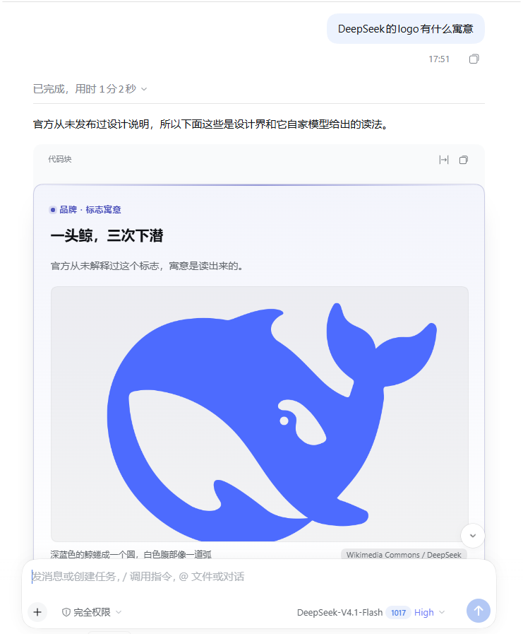

<div align="center">
  
</div>

<p align="center">
  <a href="https://github.com/deepseek-ai/deepseek-harness"></a>
  
  
  
</p>

<p align="center">让 DeepSeek Harness 的回答排版变得更好：标题、导语、要点、数据、时间线、配图。</p>

---

## 它长这样

<table>
<tr>
<td width="50%"></td>
<td width="50%"></td>
</tr>
<tr>
<td align="center"><sub>card 布局：公式、定义、对比</sub></td>
<td align="center"><sub>article 布局：长文、时间线、来源</sub></td>
</tr>
<tr>
<td colspan="2" align="center"></td>
</tr>
<tr>
<td colspan="2" align="center"><sub>article + 真实配图：写卡前先查一张图，代码块的抬头和灰框会被隐藏</sub></td>
</tr>
</table>

## 安装

```sh
dsh plugin --profile <你的 profile> add link:/path/to/dsh-rich-cards
```

装完刷新窗口即可，卡片渲染在回答末尾，不用重启会话。

## 用法

模型会自己在合适的回答末尾写一个 `card` 围栏块：

````markdown
```card
{
  "title": "一句话答案",
  "kicker": "分类 · 主题",
  "lead": "导语",
  "accent": "indigo",
  "blocks": [
    {"type": "paragraph", "text": "正文"}
  ]
}
```
````

也可以自己手写——渲染器只认 `card` 这个 info string，正文必须是合法 JSON。

配图也是这个约定的一部分：讲人物、地点、作品时先查一张真图（Windows 上用 curl 走维基图库接口），查到就配上 url + 说明 + 来源；两三次查不到就安静地不配图，不在正文里交代“接口被拦”“没找到配图”——缺图不是新闻。

| 块类型                    | 作用                              |
| ------------------------- | --------------------------------- |
| `heading` `paragraph`     | 小节标题、正文段落                |
| `bullets` `steps` `chips` | 要点、步骤、标签                  |
| `stats`                   | 2–4 个关键数字                    |
| `kv`                      | 左右对照的键值行                  |
| `callout` `quote`         | 提示框（info / tip / warn）、引用 |
| `timeline`                | 带年份的事件线                    |
| `image`                   | 真实 URL + 说明 + 来源            |
| `divider`                 | 分隔线                            |

顶层还有 `layout: "card" | "article"`（article 去掉卡片外壳，按文章排版）、`sources`（底部来源标签）、`footer`。

## 原理

- **宿主端**：往系统提示里加一段写作约定，教模型用围栏块收尾，不注册任何工具。
- **浏览器端**：`MutationObserver` 扫描回答里的代码块，正文能解析成卡片就隐藏代码、在原位挂一张卡；解析失败就原样留着。

失败即降级（fail open）：卡片写坏最多显示成一段代码，永远不会中断整轮回答——这也是它不用工具调用传参的原因。

更长的版本（为什么这么设计、两条通道的取舍、拆壳的细节）在 [docs/intro.md](docs/intro.md)。

## 已知边界

- 一张回答只渲染一张卡（最后一张生效）；
- 卡片位置固定在回答末尾，不能插到段落中间；
- 解析靠 DOM 匹配，主题改动代码块结构时可能失效。

## License

MIT
